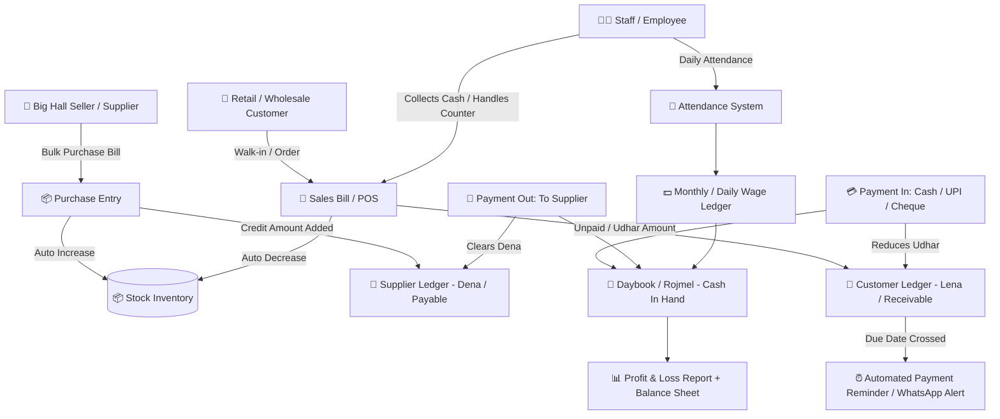
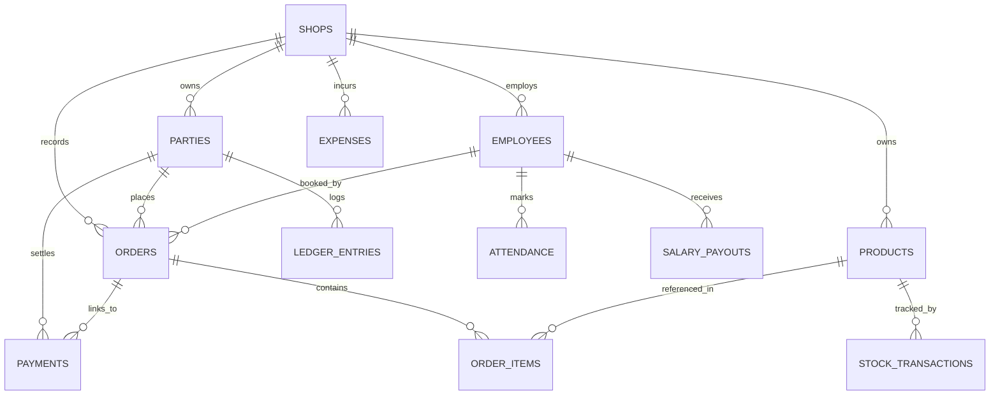

# 📒 Heshab Book (હિસાબ કિતાબ / हिसाब किताब)
### Offline-First All-in-One Business ERP, POS Billing, Stock & Khata Ledger System

> **A fast, 100% offline-first ERP and Khata accounting app built with Flutter & Drift (SQLite) for Textile Merchants, Wholesalers (Big Hall Sellers), Semi-Wholesalers, and Retail Shop Owners.**

[](https://flutter.dev)
[](https://dart.dev)
[](https://drift.simonbinder.eu/)
[](https://riverpod.dev)
[](https://flutter.dev)
[](LICENSE)

---

## 📑 Table of Contents
1. [🌟 Executive Overview](#-executive-overview)
2. [🏪 Target Business Profiles](#-target-business-profiles)
3. [🔄 End-to-End Business Operations Workflow](#-end-to-end-business-operations-workflow)
4. [✅ Currently Implemented Features](#-currently-implemented-features)
5. [🔍 Deep Analysis of Remaining & Pending Features](#-deep-analysis-of-remaining--pending-features)
   - [5.1 Product & Multi-Unit Stock Inventory](#51-product--multi-unit-stock-inventory)
   - [5.2 Parties Directory: Customer & Hall Seller Management](#52-parties-directory-customer--hall-seller-management)
   - [5.3 Complete Payment Tracking & Ledger (Khata / Udhar-Jama)](#53-complete-payment-tracking--ledger-khata--udhar-jama)
   - [5.4 Smart Next-Payment Reminders & WhatsApp Alerts](#54-smart-next-payment-reminders--whatsapp-alerts)
   - [5.5 Staff & Employee Management Module](#55-staff--employee-management-module)
   - [5.6 Invoicing, POS Engine & Hardware Printing](#56-invoicing-pos-engine--hardware-printing)
   - [5.7 Business Analytics, Daybook (Rojmel) & P&L Reports](#57-business-analytics-daybook-rojmel--pl-reports)
6. [🗄️ Relational Database Architecture & Primary Key Integrity](#️-relational-database-architecture--primary-key-integrity)
7. [🛠️ Tech Stack & Dependencies](#️-tech-stack--dependencies)
8. [🚀 Project Structure](#-project-structure)
9. [🗺️ SDLC Phased Roadmap](#️-sdlc-phased-roadmap)
10. [📤 Git Setup & First-Time Push Instructions](#-git-setup--first-time-push-instructions)

---

## 🌟 Executive Overview

**Heshab Book** is crafted to replace conventional paper khata-bahi (ખાતાવહી / लाल बही-खाता) with a fail-proof, high-speed digital system. 

### Why Heshab Book?
- **100% Offline-First**: No internet required in godowns, basements, or remote wholesale markets. Data never leaves the phone without owner consent.
- **Trilingual Native Experience**: Fluent in **English**, **Hindi (हिंदी)**, and **Gujarati (ગુજરાતી)** with auto-translation and localized number formatting (`₹1,50,000`).
- **Zero-Friction UI**: Built for non-tech-savvy business owners, accountants, counter cashiers, and shop boys.
- **Relational Integrity**: Engineered with strict Foreign Keys, Auto-Increment Primary Keys, UUID sync-readiness, and non-destructive audit logging.

---

## 🏪 Target Business Profiles

| Business Type | Typical Operations | Key Requirements |
|---|---|---|
| **Big Hall Seller (મોટા હોલસેલર / थोक विक्रेता)** | Bulk purchase from textile mills, bulk sales to retail shops, credit ledger (15-60 days credit), than/roll tracking | Party ledger, bill-wise credit terms, due-date alerts, wholesale rates |
| **Semi-Wholesaler (કટલેરી / મીક્સ હોલસેલ)** | Buys in bulk rolls/bundles, cuts & sells in retail meters or wholesale dozens | Dual pricing (Wholesale vs Retail), multi-unit conversions, barcode billing |
| **Retail Textile Shop (કાપડ / સાડી / ડ્રેસ શોપ)** | Walk-in retail customers, cash/UPI counter sales, tailor & ashtar billing | Fast POS counter billing, thermal printing, customer mobile directory |
| **General Trading & Kirana** | Multi-category products, loose & packaged stock, daily credit book | Item barcode search, customer udhar-jama ledger, daily cash counter tally |

---

## 🔄 End-to-End Business Operations Workflow

The following diagram illustrates how every department and module interacts within the **Heshab Book** ecosystem:



---

## ✅ Currently Implemented Features

### 1. 🗄️ Database & Core Layer
- [x] **Drift SQLite Engine (Schema v7)**: Full local relational persistence without any external server dependency.
- [x] **Auto-seed demo data**: Pre-loaded demo products, wholesale suppliers, and retail customer records for instant testing.
- [x] **Multi-language DB Columns**: Dual & triple script schema (`nameEn`, `nameHi`, `nameGu`) for zero-latency localized rendering.

### 2. 🌐 Multi-Language & Formatting
- [x] Instant runtime language switcher between **English**, **Hindi (हिंदी)**, and **Gujarati (ગુજરાતી)**.
- [x] Automatic Google Translate API bridge: Enter party or product name in any language and it populates En/Hi/Gu automatically.
- [x] Indian numbering format with currency symbols (`₹1,25,000`).

### 3. 📦 Products & Catalog
- [x] Add & Edit product with Name, Variety/Variant, Price, and Initial Stock.
- [x] Real-time product search with localized matching.
- [x] Product list with stock counter and price tag.

### 4. 👥 Parties (Customer & Wholesale Supplier)
- [x] Unified Party directory separated by tabs: **Customers (ગ્રાહક)** and **Suppliers (વેપારી)**.
- [x] Add/Edit Party with Name, Phone Number, and Type.
- [x] Party Search bar with dynamic filtering.

### 5. 🧾 Order & Bill Management
- [x] **Purchase Order Form**: Enter Supplier name, select products, specify quantities and unit rates, auto-calculate total.
- [x] **Sales Bill Form**: Enter Customer name, add line items, live item subtotal calculation.
- [x] Automatic stock level adjustment on bill submission (+ for Purchase, - for Sale).
- [x] Dedicated **Book Screens** (Purchase Book & Sales Book) with cumulative book balance totals.

### 6. 💰 Payments & Basic Ledger
- [x] Party details screen showing total transactions, pending balance, and received balance.
- [x] Order-level partial payment entry popup.
- [x] Payment history timeline nested under each order bill.

### 7. 🔔 Reminders & Notifications
- [x] Order-level reminder toggle and customizable reminder duration (in days).
- [x] Integration with `flutter_local_notifications` and `timezone` for scheduled device notifications.
- [x] Overdue status badge highlighting orders that passed reminder days without full payment.

---

## 🔍 Deep Analysis of Remaining & Pending Features

To transform **Heshab Book** into an enterprise-ready solution that **anyone in any business** can operate effortlessly without data loss or confusion, the following comprehensive modules are architected for implementation:

---

### 5.1 Product & Multi-Unit Stock Inventory

Textile and retail stores do not operate on simple single-unit items. A saree can be 1 Piece, unstitched suit fabric is in Meters, packaging is in Rolls/Bundles, and wholesale supply comes in "Than" (તાકા).

#### Detailed Enhancements Needed:
1. **Multi-Unit Measurement System**:
   - Primary Unit (e.g., Meter) and Secondary/Packaging Unit (e.g., Roll / Than).
   - Dynamic conversion ratio: `1 Roll = 100 Meters`, `1 Box = 12 Pieces`.
   - Bill can be created in either Unit, and the database automatically adjusts base stock.
2. **Dual-Tier Pricing**:
   - `Purchase Cost` (ખરીદી કિંમત / खरीद दर) — Visible only to owner/admin.
   - `Wholesale Price` (જથ્થાબંધ કિંમત) — Auto-applied when billing a Wholesale Party.
   - `Retail Price` (છૂટક કિંમત) — Auto-applied for walk-in retail customers.
   - `Minimum Selling Price (MRP/Floor)` — Prevents staff from selling at a loss.
3. **Barcode & QR Code Integration**:
   - Camera-based barcode scanner (`mobile_scanner`) to scan garment tags and instant add to cart.
   - In-app barcode generator for custom products with printable sticker labels.
4. **Stock Movement Audit Log (`stock_transactions`)**:
   - Never update stock directly without recording *why* it changed:
     - `PURCHASE`: Bill #INV-102 (+50 units)
     - `SALE`: Bill #BILL-401 (-2 units)
     - `CUSTOMER_RETURN`: Returned from Customer (+1 unit)
     - `SUPPLIER_RETURN`: Returned defective piece to Mill (-5 units)
     - `DAMAGE_WASTE`: Cut piece defect / water damage (-3 units)
     - `AUDIT_ADJUSTMENT`: Physical stock count correction
5. **Low Stock Alerts & Re-order Thresholds**:
   - Customizable warning level per product (e.g., Alert when Chaniya Cotton falls below 10 pcs).
   - Dedicated "Low Stock" dashboard tile with 1-tap purchase bill draft generation.

---

### 5.2 Parties Directory: Customer & Hall Seller Management

A real shopkeeper deals with diverse relationships: village retail buyers, regular city tailors, big market hall sellers, brokers, and logistics agents.

#### Detailed Enhancements Needed:
1. **Comprehensive Party Profile**:
   - **Person Name** (વ્યક્તિનું નામ / संपर्क व्यक्ति)
   - **Shop / Firm Name** (દુકાન / પેઢીનું નામ / दुकान या फर्म का नाम)
   - **Primary Mobile Number** (with direct Call & WhatsApp trigger buttons)
   - **Secondary / Landline Number**
   - **Full Address, Area, City, Pincode**
   - **GSTIN / PAN Number** (with optional 1-click GST format validation)
   - **Opening Balance**: Initial debit/credit carry-forward when onboarding old khata (`₹25,000 Baki`).
2. **Classification & Tagging**:
   - `Big Hall Seller` (થોક વેપારી)
   - `Semi-Wholesale / Sub-Dealer`
   - `Retail Customer` (છૂટક ગ્રાહક)
   - `Karigar / Job Worker` (સિલાઈ / એમ્બ્રોઈડરી કારીગર)
3. **Credit Limit & Credit Period Controls**:
   - Max Credit Limit (e.g., ₹1,00,000 maximum udhar allowed). Warning popup if a new bill exceeds this limit.
   - Credit Days Term (e.g., 30 Days credit). Bill automatically calculates due date based on this term.

---

### 5.3 Complete Payment Tracking & Ledger (Khata / Udhar-Jama)

Currently, payments are tied strictly to individual orders. In Indian trade, a customer frequently pays **₹20,000 cash lumpsum** against an outstanding balance of ₹48,000 spanning 5 different bills.

#### Detailed Enhancements Needed:
1. **Lump-Sum Account Payments (જમા ખાતું / एकमुश्त भुगतान)**:
   - Ability to receive payment against party account directly (FIFO allocation across oldest unpaid bills or unallocated credit).
2. **Multi-Mode Payment Records**:
   - `Cash` (રોકડ)
   - `UPI / QR` (GPay, PhonePe, Paytm with Transaction UTR/Ref #)
   - `Cheque` (Check #, Bank Name, Clearing Date, Status: Pending / Cleared / Bounced)
   - `Bank Transfer / NEFT / RTGS`
   - `Credit / Return Adjustment`
3. **Full Statement & Passbook View (ખાતાવહી / Ledger Statement)**:
   - Date-wise Debit (ઉધાર), Credit (જમા), and Running Balance column.
   - Download professional Ledger PDF Statement to share with party on WhatsApp.
   - "Hisab Tally" button to lock reconciled periods.

---

### 5.4 Smart Next-Payment Reminders & WhatsApp Alerts

Collecting pending money on time is the single biggest pain point for small business owners.

#### Detailed Enhancements Needed:
1. **Custom Due Date & Reminders**:
   - Specific Date picker for next payment date (e.g., "Customer promised to pay on 25th of next month").
   - Follow-up notes (e.g., "Call after 4 PM after their shop closes").
2. **1-Tap WhatsApp Payment Reminder**:
   - Auto-generated WhatsApp message in English, Gujarati, or Hindi:
     ```text
     નમસ્તે રમેશભાઈ,
     શ્રી ગણેશ ટેક્સટાઈલ્સ માંથી આપનું બાકી બિલ રકમ ₹14,500 છે. 
     ચુકવણીની છેલ્લી તારીખ 25/10/2026 હતી.
     કૃપા કરીને નીચે આપેલ UPI દ્વારા ચુકવણી કરવા વિનંતી:
     UPI ID: shop@upi
     આભાર!
     ```
3. **Overdue Buckets & Collection Dashboard**:
   - 0–15 Days Overdue (Mild reminder)
   - 16–30 Days Overdue (Moderate alert)
   - 30+ Days Critical Overdue (Red flag alert on home screen)

---

### 5.5 Staff & Employee Management Module

A comprehensive shop ERP must allow staff to operate billing without exposing master financials, while tracking staff costs and attendance.

#### Detailed Enhancements Needed:
1. **Employee Master Directory**:
   - Full Name, Phone, Aadhaar/ID, Photo, Joining Date.
   - Designation: `Cashier`, `Sales Counter Boy`, `Master Cutter / Tailor`, `Store Manager`.
   - Salary Type: `Monthly Fixed`, `Daily Wage (દિહાડી)`, or `Sales Commission (%)`.
2. **Daily Attendance Register (હાજરી પત્રક)**:
   - Quick attendance grid: **Present (હાજર)**, **Absent (ગેરહાજર)**, **Half-Day (અડધો દિવસ)**, **Paid Leave**.
   - Monthly attendance summary card with auto-calculated working days.
3. **Advance & Salary Ledger (ઉપાડ / ખર્ચ ખાતું)**:
   - Staff often take weekly advance cash (ઉપાડ).
   - Record advance payout → Auto-deduct from end-of-month salary payout voucher.
4. **Role-Based Access Control (Security)**:
   - **Owner / Admin**: Full access to all reports, profit margins, supplier rates, and delete operations.
   - **Salesman / Cashier**: Can only create bills, view products, and accept payments. Cannot edit purchase prices or delete historical transactions.
   - App Lock with 4-digit master PIN or Biometric Fingerprint/FaceID.

---

### 5.6 Invoicing, POS Engine & Hardware Printing

Speed at the counter determines customer satisfaction during festival and wedding rush seasons.

#### Detailed Enhancements Needed:
1. **Fast POS Billing Interface**:
   - Large numeric keypad option for touchscreens.
   - Instant search by Name, Code, Barcode, or Category.
   - Line-item discounts (₹ or %) and bill-level round-off.
   - Non-GST and GST (CGST + SGST or IGST) invoice toggles.
2. **Hardware & Thermal Printer Support**:
   - Bluetooth / USB Thermal ESC/POS receipt printer support (58mm and 80mm roll).
   - Instant slip print: Shop Name, Phone, GSTIN, Items, Qty, Total, Paid, Balance, Thank you message.
3. **A4 / A5 Tax Invoice PDF Export**:
   - Generate official Tax Invoices with shop logo, terms & conditions, bank account details, and authorized signature box.
   - Direct PDF share via WhatsApp, Email, or AirPrint.

---

### 5.7 Business Analytics, Daybook (Rojmel) & P&L Reports

Without daily tallying, cash leaks and calculation errors occur frequently in cash-intensive businesses.

#### Detailed Enhancements Needed:
1. **Daily Rojmel / Cash Book (રોજમેળ / दैनिक रोकड़ बही)**:
   ```text
   Opening Cash in Drawer:           ₹15,000
   + Total Cash Sales Today:         ₹42,500
   + Cash Payments Received (Udhar): ₹12,000
   -----------------------------------------
   Total Cash Available:             ₹69,500
   - Cash Purchases:                -₹10,000
   - Cash Paid to Suppliers:         -₹8,000
   - Shop Daily Expenses (Tea/Fuel):   -₹750
   - Staff Advance / Wages:          -₹2,000
   -----------------------------------------
   Closing Cash Expected in Hand:    ₹48,750
   ```
2. **Net Profit & Loss Statement (P&L)**:
   - Gross Profit = Net Revenue − Cost of Goods Sold (COGS).
   - Net Profit = Gross Profit − Operating Expenses (Rent, Electricity, Salaries, Miscellaneous).
3. **Inventory Valuation Report**:
   - Total stock on hand valued at Purchase Cost vs Retail Value.

---

## 🗄️ Relational Database Architecture & Primary Key Integrity

The core database is managed via **Drift ORM (SQLite)**. To ensure zero duplicate records, rapid indexing, and cloud-readiness, every table enforces strict constraints.

### Schema Blueprint



### Table Definitions & Primary Key Strategy

| Table | Primary Key | Foreign Keys | Key Columns | Integrity Rules |
|---|---|---|---|---|
| `shops` | `id` (INTEGER AUTOINCREMENT) | None | `uuid`, `name`, `owner_name`, `phone`, `gstin`, `address`, `created_at` | Root entity. Multi-shop ready. |
| `users` | `id` (INTEGER AUTOINCREMENT) | `shop_id` | `uuid`, `name`, `phone`, `pin_hash`, `role` (Admin/Cashier) | Admin PIN protection. |
| `parties` | `id` (INTEGER AUTOINCREMENT) | `shop_id` | `uuid`, `name_en`, `name_hi`, `name_gu`, `firm_name`, `phone`, `alt_phone`, `address`, `gstin`, `type` (Wholesale/Retail), `credit_limit`, `opening_balance`, `is_active` | Indexed on `phone`, `firm_name`, and `name_en`. Unique UUID. |
| `products` | `id` (INTEGER AUTOINCREMENT) | `shop_id`, `category_id`, `unit_id` | `uuid`, `code_barcode`, `name_en`, `name_hi`, `name_gu`, `variety_en`, `purchase_price`, `retail_price`, `wholesale_price`, `stock`, `min_alert_stock`, `is_active` | Unique barcode/code index. Price non-negative. |
| `units` | `id` (INTEGER AUTOINCREMENT) | `shop_id` | `name_en`, `name_hi`, `name_gu`, `short_code`, `conversion_factor` | Meter, Pcs, Roll, Bundle, Than, Kg. |
| `orders` | `id` (INTEGER AUTOINCREMENT) | `shop_id`, `party_id`, `employee_id` | `uuid`, `invoice_no`, `type` (Purchase/Sale/Return), `date`, `total_amount`, `discount`, `tax_amount`, `paid_amount`, `payment_status`, `payment_mode`, `due_date`, `reminder_enabled` | Strict foreign key on `party_id`. Indexed by `date` & `invoice_no`. |
| `order_items`| `id` (INTEGER AUTOINCREMENT) | `order_id` (CASCADE), `product_id` (RESTRICT) | `quantity`, `unit_price`, `total`, `unit_id` | Cannot delete a product referenced in an active bill. |
| `payments` | `id` (INTEGER AUTOINCREMENT) | `party_id`, `order_id` (NULLABLE) | `uuid`, `date`, `amount`, `payment_mode` (Cash/UPI/Cheque), `ref_number`, `note`, `collected_by` | Tracks both bill-level and lump-sum party receipts. |
| `stock_transactions`| `id` (INTEGER AUTOINCREMENT) | `product_id`, `order_id` (NULLABLE) | `type` (IN/OUT/DAMAGE/ADJUST), `quantity`, `balance_after`, `date`, `remarks` | Immutable audit ledger. |
| `employees` | `id` (INTEGER AUTOINCREMENT) | `shop_id` | `name`, `phone`, `role`, `salary_type`, `base_rate`, `joining_date`, `is_active` | Staff master directory. |
| `attendance`| `id` (INTEGER AUTOINCREMENT) | `employee_id` (CASCADE) | `date`, `status` (Present/Absent/HalfDay/Leave), `note` | Unique index on `(employee_id, date)`. |
| `salary_payouts`| `id` (INTEGER AUTOINCREMENT) | `employee_id` | `date`, `amount`, `type` (Advance/Salary/Bonus), `payment_mode`, `note` | Staff salary & upaad tracking. |
| `expenses` | `id` (INTEGER AUTOINCREMENT) | `shop_id` | `category`, `amount`, `date`, `payment_mode`, `note` | Daily shop overhead costs. |

---

## 🛠️ Tech Stack & Dependencies

```yaml
environment:
  sdk: ^3.11.3
  flutter: ">=3.24.0"

dependencies:
  flutter:
    sdk: flutter
  cupertino_icons: ^1.0.8

  # State Management
  flutter_riverpod: ^2.6.1
  riverpod_annotation: ^2.6.1

  # Local Relational Database (SQLite)
  drift: ^2.26.1
  drift_flutter: ^0.2.4
  sqlite3_flutter_libs: ^0.5.42
  path_provider: ^2.1.5
  path: ^1.9.1

  # Navigation & Routing
  go_router: ^15.1.2

  # Typography & Design
  google_fonts: ^6.2.1

  # Persistence & Preferences
  shared_preferences: ^2.5.5

  # Localization & Utilities
  intl: ^0.20.2
  translator: ^1.0.4+1
  flutter_local_notifications: ^21.0.0
  timezone: ^0.11.0

dev_dependencies:
  build_runner: ^2.4.15
  riverpod_generator: ^2.6.4
  drift_dev: ^2.26.1
  flutter_launcher_icons: ^0.14.4
  flutter_native_splash: ^2.4.7
  flutter_lints: ^6.0.0
```

---

## 🚀 Project Structure

```
heshab_book_app/
├── android/                   # Native Android configuration
├── ios/                       # Native iOS configuration
├── assets/                    # App icons, illustrations, sound assets
├── lib/
│   ├── database/              # Drift Database Layer
│   │   ├── database.dart      # Tables, DAOs, Migrations, Seed Data
│   │   └── database.g.dart    # Drift auto-generated code
│   ├── l10n/                  # Localization (Gujarati, Hindi, English)
│   │   └── app_translations.dart
│   ├── providers/             # Riverpod Providers & State Notifiers
│   │   ├── database_provider.dart
│   │   └── settings_provider.dart
│   ├── screens/               # User Interface Presentation Screens
│   │   ├── main_screen.dart           # Bottom navigation shell
│   │   ├── home_screen.dart           # Dashboard & business snapshot
│   │   ├── book_screen.dart           # Sales & Purchase books
│   │   ├── order_form_screen.dart     # Billing & Purchase creation
│   │   ├── parties_screen.dart        # Customer & Supplier lists
│   │   ├── party_details_screen.dart  # Party Khata, payments & timeline
│   │   ├── products_screen.dart       # Stock catalog & item manager
│   │   ├── settings_screen.dart       # Theme, language, shop details
│   │   └── onboarding_screen.dart     # First-launch welcome walkthrough
│   ├── theme/                 # App Theme (Khata Red, Light & Dark themes)
│   │   └── app_theme.dart
│   ├── utils/                 # Utilities & Services
│   │   ├── notification_helper.dart  # Local scheduled reminders
│   │   └── translation_helper.dart   # On-the-fly translation helper
│   └── main.dart              # App entry point, routing & initialization
├── pubspec.yaml               # Dependencies & assets configuration
└── README.md                  # Comprehensive Documentation & Blueprint
```

---

## 🗺️ SDLC Phased Roadmap

```
Phase 1: Database Expansion & Entity Models ───────────────► [Ready to build]
         - Add Shop, Employee, Attendance, StockTransaction tables
         - Expand Party with Firm Name, Address, GSTIN, Opening Balance
         - Expand Products with Barcode, Multi-unit, Purchase vs Retail price

Phase 2: Enhanced Khata & Payment Management ──────────────► [Planned]
         - Lump-sum payment receipt against party account
         - Payment mode dropdown (Cash, UPI, Cheque, Bank)
         - Next payment due date picker with WhatsApp reminder share

Phase 3: Employee & Attendance System ─────────────────────► [Planned]
         - Staff list, Daily attendance punch (P/A/HD)
         - Advance payment (Upaad) ledger & monthly salary settlement
         - Master PIN lock for owner screens

Phase 4: POS Billing & Hardware Printing ──────────────────► [Planned]
         - Camera Barcode Scanner
         - Bluetooth Thermal Receipt (58mm/80mm ESC/POS) integration
         - Professional A4/A5 PDF Invoice generation

Phase 5: Financial Intelligence & Local Backup ────────────► [Planned]
         - Daily Daybook (Rojmel) cash drawer tally
         - Profit & Loss statement
         - 1-click encrypted SQLite & JSON backup/restore to Phone / WhatsApp
```

---

## 📤 Git Setup & First-Time Push Instructions

To link this local workspace to your personal GitHub repository (`MrManavRamani-Flutter/heshab_book_app`) and push:

### Step 1: Update Remote URL
```bash
git remote set-url origin https://github.com/MrManavRamani-Flutter/heshab_book_app.git
```
*(Or if using SSH keys)*:
```bash
git remote set-url origin git@github.com:MrManavRamani-Flutter/heshab_book_app.git
```

### Step 2: Verify Remote URL
```bash
git remote -v
```

### Step 3: Stage All Changes & Commit
```bash
git add .
git commit -m "docs: comprehensive business erp roadmap, detailed feature analysis, and architecture blueprint"
```

### Step 4: Push to Main Branch
```bash
git branch -M main
git push -u origin main
```

---

## 🤝 Support & Contribution

- **Author**: Manav Ramani ([@MrManavRamani-Flutter](https://github.com/MrManavRamani-Flutter))
- **Primary Market**: Small, Medium & Wholesale Textile and Retail Businesses
- **Vision**: To empower every shopkeeper with an effortless, transparent, and offline-reliable digital accountant.
# heshab_book_app
